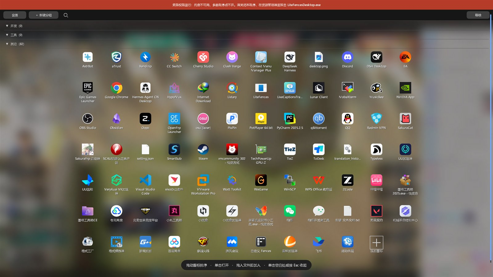
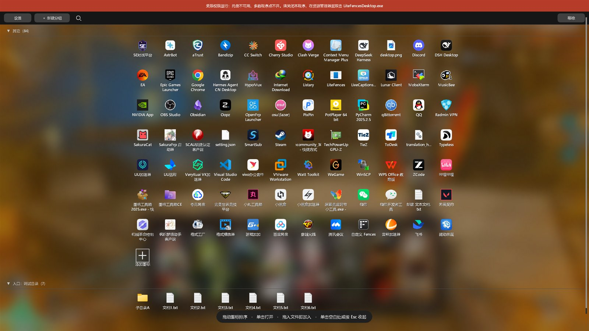
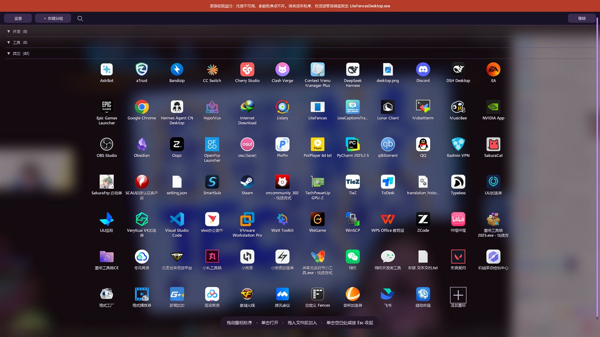
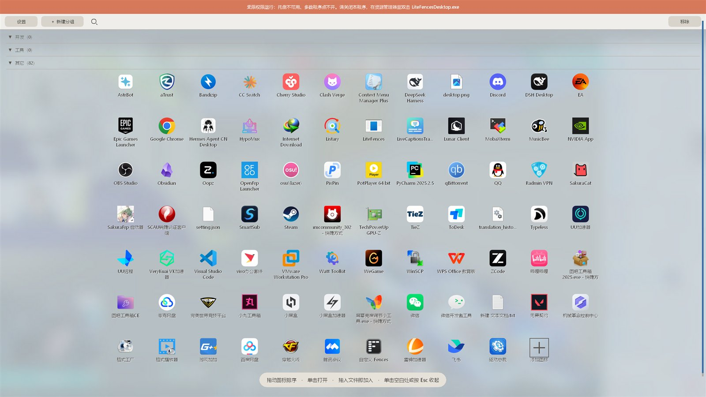

<div align="center">
  
  <h1>LiteFences</h1>
  <p><strong>把桌面图标收进一块随叫随到的磨砂面板。</strong></p>
  <p>Windows 11 · Rust + Win32 · 常驻托盘 · 只整理，不动文件</p>
  <p>
    
    
    
    
  </p>
  <p>
    <a href="#快速开始"><strong>快速开始</strong></a> ·
    <a href="docs/desktop-launcher.md">使用说明</a> ·
    <a href="CHANGELOG.md">更新日志</a> ·
    <a href="https://github.com/Ltsunahi/LiteFences/releases/latest">下载</a>
  </p>
</div>

<a href="docs/images/panel.jpg"></a>

## 一块面板，装下整个桌面

LiteFences 启动后没有主窗口，也没有任务栏按钮，只在托盘里待命。
按下 `Ctrl+Alt+Space`，桌面图标会以一块全屏磨砂面板的形式铺开：分组、搜索、启动，都在同一处完成。

> **只整理，不动文件。** 拖进面板的项目只记录路径；从面板移除也只是取消引用。源文件永远留在原处。

| | | |
|:--|:--|:--|
| **⚡ 唤出即用**<br>热键、托盘或双击桌面空白处唤出；`Esc` 或单击空白收起。 | **🔍 直接打字搜索**<br>`bdwp` → 百度网盘，`vsc` → Visual Studio Code。拼音首字母、英文缩写、名称子串都能命中。 | **🗂️ 自动分组**<br>图标按分组铺开，可折叠、改名、拖标题调顺序，也能把图标拖到别的组。 |
| **📥 拖入即归档**<br>从资源管理器拖文件、文件夹、快捷方式进来，只加引用，永不移动源文件。 | **🪶 原生轻量**<br>Rust + Win32，没有 Electron / WebView；开发机实测常驻私有内存约 8 MB，空闲 CPU ≈ 0。 | **🎨 五套主题 · 双语**<br>深空蓝、石墨灰、午夜紫、森林绿、暖砂；简体中文 / English 随时切换。 |

## 界面

<table>
  <tr>
    <td width="50%"></td>
    <td width="50%"></td>
  </tr>
  <tr>
    <td align="center"><sub>文件夹入口：把目录挂成只读分组</sub></td>
    <td align="center"><sub>午夜紫：五套主题之一</sub></td>
  </tr>
</table>


<p align="center"><sub>暖砂（浅色主题）</sub></p>

## 快速开始

### 安装版（推荐）

1. 从 [Releases](https://github.com/Ltsunahi/LiteFences/releases/latest) 下载 `LiteFences-x.y.z-x64.msi`。
2. 双击安装，一路下一步。按用户安装，不需要管理员权限。
3. 托盘出现图标即启动完成，按 `Ctrl+Alt+Space` 唤出面板。

卸载走「设置 → 应用」；`%LOCALAPPDATA%\LiteFencesDesktop` 里的配置不会被删除。

### 便携版

直接运行 `LiteFencesDesktop.exe`。配置位置与安装版相同，拷走 exe 即可带走程序本身。

## 快捷键

| 按键 | 作用 |
|:--|:--|
| `Ctrl+Alt+Space` | 唤出 / 收起面板 |
| `Ctrl+Alt+Q` | 退出 LiteFences |
| 字母 / 数字 | 唤出后直接打字搜索 |
| `Backspace` | 删除搜索字符；删空后再按一次收起搜索 |
| `↑` `↓` `←` `→` | 在图标或搜索结果之间移动 |
| `Enter` | 打开选中项 |
| `Tab` / `Shift+Tab` | 跳到下一个 / 上一个分组 |
| `Esc` | 清除搜索；再按一次收起面板 |

搜索只接收 ASCII 字母和数字（拼音首字母），不支持在面板里直接用中文输入法打字。

## 构建

需要 Windows x64 + MSVC（Visual Studio 的 C++ 生成工具），Rust 版本见 `rust-toolchain.toml`。

```powershell
cargo build --release --features shell --locked
cargo test --release --features shell --locked --bin litefences-desktop

# 产物：target\release\litefences-desktop.exe
```

产物静态链接 CRT（`.cargo/config.toml` 里 `+crt-static`），拷到没装 VC++ 运行库的机器上也能直接运行。

打 MSI（WiX v5）：

```powershell
dotnet tool install --global wix --version 5.*
.\scripts\Build-Msi.ps1                 # 版本号取自 Cargo.toml
.\scripts\Build-Msi.ps1 -Culture en-us  # 英文安装向导
```

<details>
<summary><strong>数据放在哪里</strong></summary>

全部在 `%LOCALAPPDATA%\LiteFencesDesktop\`：

| 文件 | 内容 |
|:--|:--|
| `config.json` | 全部配置：热键、主题、语言、图标顺序、分组、文件夹入口 |
| `config.json.bak` | 上一次保存前的备份 |
| `config.broken.json` | 解析失败时自动留底的坏文件（正常不会有） |
| `launcher.log` | 运行日志，512 KiB 轮换 |

写入采用「先写临时文件再改名」的原子替换；解析失败会备份坏文件并退回默认配置。
旧版的 `layout.txt` / `groups.txt` / `portals.txt` / `settings.txt` 会在首次启动时自动迁移。

</details>

<details>
<summary><strong>已知限制</strong></summary>

- 没有代码签名：新版本首次运行时 Windows 可能提示「已保护你的电脑」，点「仍要运行」即可。
- 只在 Win11 + 单屏开发机上实测过；Win10、多屏 / 混合 DPI 还没有实机验证。
- 受限权限（低完整性级别）下托盘创建会失败，热键仍然可用。
- 桌面空白双击唤出依赖系统鼠标钩子，装了其它桌面整理软件时可能被抢。
- 搜索只支持拼音首字母和 ASCII，中文输入法不能直接在面板里打字。

</details>

<details>
<summary><strong>仓库结构</strong></summary>

| 路径 | 说明 |
|:--|:--|
| `src/bin/litefences_desktop*` | 当前主线：桌面启动器（Cargo feature `shell`） |
| `src/core`、`src/storage`、`src/platform`、`src/main.rs` | 早期普通窗口原型（v1），保留作参考 |
| `docs/desktop-launcher.md` | 功能、实现细节与每轮验证记录 |
| `docs/images/` | README 截图与图标 |
| `scripts/` | 构建、打包、验收辅助脚本 |

</details>

<details>
<summary><strong>English</strong></summary>

LiteFences is a lightweight Windows desktop launcher written in Rust + Win32.
It lives in the tray without a main window and summons a full-screen frosted panel of your desktop icons.
Icons can be grouped, searched by pinyin initials or English acronyms, and files can be dragged in from Explorer —
always by reference only, never moving the originals. The UI is available in Simplified Chinese and English.

Build on Windows x64 with MSVC:

```powershell
cargo build --release --features shell --locked
```

</details>

## License

[MIT](LICENSE) · 与 Stardock 无任何关系，也未使用其代码。
