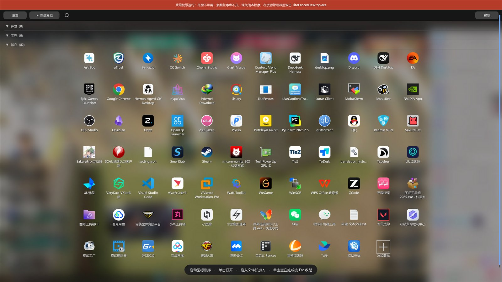
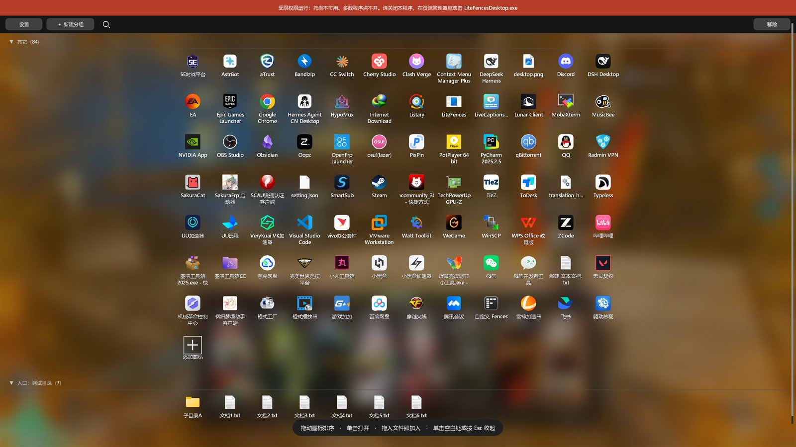
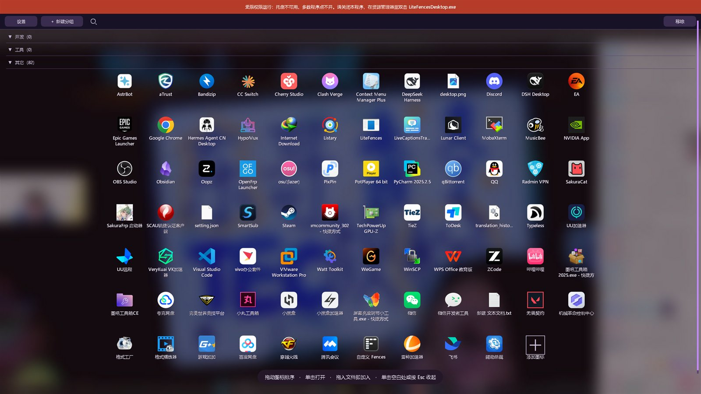
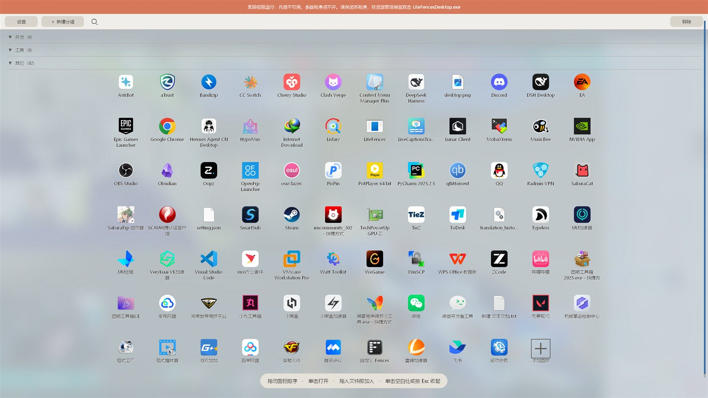

# LiteFences

轻量的 Windows 桌面启动器：**后台常驻、唤出即用的磨砂玻璃面板**。桌面图标自动按分组铺开，
文件直接拖进来就归档——全程只记录路径，不移动你的任何文件。



> 名字里的 Fences 只是致敬这类“桌面整理”软件；本项目与 Stardock 无任何关系，也没有使用它的代码。

## 它是什么

- **不是窗口程序**：启动后没有主窗口、没有任务栏按钮、不进 Alt+Tab，只在后台待命。
- **唤出即用**：`Ctrl+Alt+Space`（或托盘图标 / 桌面空白双击）唤出整屏磨砂面板，内容就是你的桌面图标。
- **只读整理**：拖进来的文件只记路径，**不移动、不复制、不删除**源文件；移除只是从面板上拿掉。
- **纯 Win32 + Rust**：没有 Electron/WebView，常驻私有内存约 8 MB，空闲 CPU ≈ 0。

## 功能

| 分类 | 现在能做什么 |
| --- | --- |
| 面板 | 整屏磨砂底板、淡入 + 上滑入场动画、标题吸顶、滚轮滚动、右侧细滚动条 |
| 图标 | 读桌面图标（含公共桌面/OneDrive）、单击启动、拖动排序、网格自动分列 |
| 分组 | 新建 / 折叠 / 重命名 / 删除、拖动标题调顺序、跨组移动图标 |
| 拖入 | 从资源管理器把文件、文件夹、快捷方式拖进任意分组（只加引用，永不 MOVE） |
| 文件夹入口 | 把目录挂成只读分组，文件夹在前；可按名称 / 修改时间排序 |
| 搜索 | 工具条放大镜展开搜索框，按名字过滤 |
| 整理 | 改名、换 `.ico` 图标、恢复默认图标、移除模式 |
| 主题 | 深空蓝 / 石墨灰 / 午夜紫 / 森林绿 / 暖砂（浅色），菜单里切换 |
| 常驻 | 托盘图标、可改唤出热键、开机自启、有界日志 |
| 语言 | 简体中文 / English，跟随系统或手动切换（设置菜单 → 语言） |

| 文件夹入口 | 午夜紫 |
| --- | --- |
|  |  |

## 截图：浅色主题



## 安装

**推荐 MSI**（按用户安装，不需要管理员权限，向导为简体中文）：双击 `LiteFences-x.y.z-x64.msi` 一路下一步，
装到 `%LOCALAPPDATA%\Programs\LiteFences`，并创建开始菜单 / 桌面快捷方式和卸载项。
卸载走「设置 → 应用」；`%LOCALAPPDATA%\LiteFencesDesktop` 里的配置不会被删。

也可以不安装，直接运行 `LiteFencesDesktop.exe`（便携用法，配置位置一样）。

## 构建

需要 Windows x64 + MSVC（Visual Studio 的 C++ 生成工具），Rust 版本见 `rust-toolchain.toml`。

```powershell
cargo build --release --features shell --locked
# 产物：target\release\litefences-desktop.exe（约 390 KB）
```

不需要管理员权限，也不写注册表（除了「开机自启」会在 `HKCU\...\Run` 下加一个值）。

打 MSI（WiX v5：`dotnet tool install --global wix --version 5.*`）：

```powershell
.\scripts\Build-Msi.ps1              # 版本号取自 Cargo.toml，产物在 dist\
.\scripts\Build-Msi.ps1 -Culture en-us # 英文安装向导
```

## 使用

1. 双击 `LiteFencesDesktop.exe`，通知区出现图标，没有窗口。
2. `Ctrl+Alt+Space` 唤出面板；桌面图标被临时隐藏，面板里就是它们。
3. 单击图标启动；拖动图标换位；拖到别的分组标题上即移入。
4. 从资源管理器把文件拖到面板上松手，就加进松手位置所在的分组。
5. 单击空白处或按 `Esc` 收起，桌面图标恢复。

完整说明（含右键菜单、搜索、移除模式、文件夹入口、主题）见 [使用说明](docs/desktop-launcher.md)。

## 数据文件

全部在 `%LOCALAPPDATA%\LiteFencesDesktop\`，都是纯文本，可以直接编辑：

| 文件 | 内容 |
| --- | --- |
| `layout.txt` | 面板顺序与显示名：`路径<TAB>显示名[<TAB>图标文件]` |
| `groups.txt` | 分组：`[组名]` 分段，`[!组名]` 表示默认折叠 |
| `portals.txt` | 文件夹入口：`目录<TAB>显示名<TAB>折叠<TAB>排序` |
| `custom-icons.txt` | 手动添加的图标路径 |
| `hidden-icons.txt` | 从面板移除的桌面图标 |
| `settings.txt` | 热键与主题 |
| `launcher.log` | 运行日志（512 KiB 轮换） |

## 已知限制

- 没有代码签名：换新版本首次运行时 Windows 可能提示「已保护你的电脑」，点「仍要运行」即可。
- 多屏 / 混合 DPI 只有代码路径，没有第二块屏实机验证；Win10 也没有实机跑过。
- 受限权限（低完整性级别）下托盘创建会失败，热键仍然可用。
- 桌面空白双击唤出依赖系统鼠标钩子，装了其它桌面整理软件时可能被抢。

## 仓库结构

| 路径 | 说明 |
| --- | --- |
| `src/bin/litefences_desktop*` | **当前主线**：桌面启动器（`--features shell`） |
| `src/core`、`src/storage`、`src/platform`、`src/main.rs` | 早期普通窗口原型（v1），保留作参考，开发记录见 [docs/development-log-v1.md](docs/development-log-v1.md) |
| `docs/desktop-launcher.md` | 桌面启动器的功能、实现细节和每轮验证记录 |
| `docs/images/` | README 用截图 |
| `scripts/` | 构建/验收辅助脚本 |

## 开发

提交尽量小而可验证；改完跑：

```powershell
cargo test --release --features shell --locked --bin litefences-desktop
cargo build --release --features shell --locked
```

## License

[MIT](LICENSE)

---

**English**: LiteFences is a lightweight Windows desktop launcher written in Rust + Win32.
The UI is available in Simplified Chinese and English (Settings → Language → Follow system / 中文 / English).
It stays in the tray with no window, summons a full-screen frosted panel of your desktop icons,
groups them, and accepts files dropped from Explorer — always by reference only, never moving your files.
Build with `cargo build --release --features shell --locked` on Windows x64 with MSVC.
